# MER implementado de `matching-laboral-ort`

Fecha de actualización: 15 de octubre de 2026.

Este documento representa la arquitectura aplicada en Supabase mediante la migración `normalizar_arquitectura_matching`. Auth y Storage aparecen como sistemas externos administrados por Supabase. No forman parte del schema funcional que mantiene la aplicación.

## 1. Criterios de diseño

1. Facultad es una relación muchos a muchos entre ofertas y facultades. `ofertas_laborales` no tiene `facultad_id`.
2. Las señales principales del matching tienen catálogos y tablas puente.
3. Los textos originales de ORT se conservan para trazabilidad y como respaldo.
4. El backend consume las relaciones normalizadas y mantiene compatibilidad con el contrato actual de la interfaz.
5. Los perfiles, sus clasificaciones y sus documentos continúan siendo privados.
6. Los administradores conservan una membresía privada simple. No se agregó un sistema genérico de roles sin una necesidad funcional.
7. Storage se referencia lógicamente por bucket y ruta. No se crearon FK hacia tablas internas de Supabase.
8. Los scores se calculan en tiempo real y no se persisten.

## 2. MER físico actual

```mermaid
erDiagram
    AUTH_USERS ||--o| PERFILES_ESTUDIANTES : "user_id UNIQUE"
    AUTH_USERS ||--o| ADMINISTRADORES : "user_id"
    AUTH_USERS ||--o{ OFERTAS_LABORALES : "creada_por"
    AUTH_USERS ||--o{ OFERTAS_LABORALES : "actualizada_por"

    FACULTADES ||--o{ CARRERAS : "facultad_id opcional"
    CARRERAS ||--o{ PERFILES_ESTUDIANTES : "carrera_id"
    PERFILES_ESTUDIANTES ||--o| PREFERENCIAS_MATCHING : "perfil_id PK y FK"

    PERFILES_ESTUDIANTES ||--o{ PERFIL_AREAS_INTERES : "perfil_id"
    AREAS_INTERES ||--o{ PERFIL_AREAS_INTERES : "area_id"
    OFERTAS_LABORALES ||--o{ OFERTA_AREAS_INTERES : "oferta_id"
    AREAS_INTERES ||--o{ OFERTA_AREAS_INTERES : "area_id"

    PERFILES_ESTUDIANTES ||--o{ PERFIL_SKILLS : "perfil_id"
    SKILLS ||--o{ PERFIL_SKILLS : "skill_id"
    OFERTAS_LABORALES ||--o{ OFERTA_SKILLS : "oferta_id"
    SKILLS ||--o{ OFERTA_SKILLS : "skill_id"
    SKILLS ||--o{ SKILL_ALIASES : "skill_id"

    PERFILES_ESTUDIANTES ||--o{ PERFIL_IDIOMAS : "perfil_id"
    IDIOMAS ||--o{ PERFIL_IDIOMAS : "idioma_id"
    IDIOMAS ||--o{ IDIOMA_ALIASES : "idioma_id"
    OFERTAS_LABORALES ||--o{ OFERTA_IDIOMAS : "oferta_id"
    IDIOMAS ||--o{ OFERTA_IDIOMAS : "idioma_id"

    OFERTAS_LABORALES ||--o{ OFERTA_FACULTADES : "oferta_id"
    FACULTADES ||--o{ OFERTA_FACULTADES : "facultad_id"

    OFERTAS_LABORALES ||--o{ OFERTA_CARRERAS : "oferta_id"
    CARRERAS ||--o{ OFERTA_CARRERAS : "carrera_id"

    TIPOS_CONTRATO ||--o{ OFERTAS_LABORALES : "tipo_contrato_id"
    TIPOS_CARGO ||--o{ OFERTAS_LABORALES : "tipo_cargo_id"
    ORGANIZACIONES ||--o{ OFERTAS_LABORALES : "organizacion_id opcional"

    PERFILES_ESTUDIANTES ||--o{ INTERACCIONES_OFERTAS : "user_id lógico"
    OFERTAS_LABORALES ||--o{ INTERACCIONES_OFERTAS : "oferta_id"

    PERFILES_ESTUDIANTES ||--o{ DOCUMENTOS_ESTUDIANTE : "perfil_id"
    DOCUMENTOS_ESTUDIANTE ||..o| STORAGE_OBJECTS : "bucket_id + object_path"
    STORAGE_BUCKETS ||--o{ STORAGE_OBJECTS : "bucket_id"

    OFERTAS_LABORALES ||--o{ CANALES_POSTULACION : "oferta_id"
```

La relación punteada entre `documentos_estudiante` y `storage.objects` es lógica. No existe una FK física hacia el schema administrado por Supabase.

## 3. Núcleo de identidad y seguridad

### `auth.users`

Entidad de identidad administrada por Supabase Auth. Su PK es `id uuid`.

### `public.perfiles_estudiantes`

Mantiene la relación uno a cero o uno con `auth.users` mediante `user_id UNIQUE`. Conserva los campos personales, de disponibilidad y las columnas heredadas de texto o arrays usadas por la interfaz.

Columnas estructurales nuevas:

| Columna | Relación |
|---|---|
| `carrera_id` | FK opcional a `carreras.id`. |
| `modalidad_preferida` | CHECK con los valores admitidos por el producto. |

Las columnas `carrera`, `areas_interes`, `skills` e `idiomas` permanecen como contrato de entrada. Triggers sincronizan sus catálogos y tablas puente. Esto permite migrar sin romper el formulario existente.

### `public.preferencias_matching`

Mantiene una relación uno a cero o uno con `perfiles_estudiantes`: `perfil_id` es simultáneamente PK y FK con borrado en cascada. Guarda por separado los pesos de skills, áreas, carrera, modalidad, jornada, horario y salario. La ausencia de fila significa “pesos recomendados”, por lo que los usuarios existentes conservan el comportamiento histórico. Salario queda preparado con mínimo deseado, moneda y periodicidad, pero su peso permanece en cero mientras las ofertas no tengan importes estructurados comparables.

RLS permite seleccionar, insertar, actualizar o eliminar únicamente la fila asociada al perfil del usuario autenticado. El backend normaliza los pesos a 100 antes de persistirlos y los CHECK de la tabla mantienen cada valor entre 0 y 100.

### `private.administradores`

Continúa siendo la fuente privada del rol administrativo. La aplicación no necesitaba roles adicionales, por lo que no se introdujeron `roles` y `usuario_roles`.

### `public.interacciones_ofertas`

La columna `user_id` ahora referencia `perfiles_estudiantes(user_id)`. Esto impide crear interacciones para identidades que no tengan perfil de estudiante.

Su PK sigue siendo `(user_id, oferta_id)` y `estado` mantiene el CHECK `guardada` o `descartada`. Se agregó `fecha_creacion` y se conserva `fecha_actualizacion`.

## 4. Catálogos académicos y de matching

### Facultades y carreras

| Tabla | Finalidad |
|---|---|
| `facultades` | Catálogo de las cinco facultades reales observadas. |
| `carreras` | Catálogo de carreras declaradas. `facultad_id` es opcional porque no se asignan equivalencias sin una fuente confiable. |
| `oferta_facultades` | Relación muchos a muchos proveniente del campo ORT. |
| `oferta_carreras` | Carreras aceptadas o inferidas para una oferta. |

`oferta_facultades` reemplaza conceptualmente al texto multivaluado. El texto original se conserva como dato de origen.

### Áreas de interés

| Tabla | Finalidad |
|---|---|
| `areas_interes` | Catálogo normalizado. |
| `perfil_areas_interes` | Áreas declaradas por el estudiante. |
| `oferta_areas_interes` | Áreas clasificadas para una oferta. |

Las relaciones de oferta guardan `fuente` y `verificada`. Una inferencia automática no se presenta como clasificación manual.

### Skills

| Tabla | Finalidad |
|---|---|
| `skills` | Concepto canónico, por ejemplo `Power BI`. |
| `skill_aliases` | Variantes normalizadas como `powerbi` o `power bi`. |
| `perfil_skills` | Skills declaradas por el estudiante. |
| `oferta_skills` | Skills detectadas o confirmadas en una oferta. |

La PK de las tablas puente evita duplicados. `skill_aliases.alias_normalizado` es UNIQUE globalmente para evitar que un alias identifique dos skills.

### Idiomas

| Tabla | Finalidad |
|---|---|
| `idiomas` | Catálogo canónico. |
| `idioma_aliases` | Normaliza variantes como `ingles`, `Inglés` y `English`. |
| `perfil_idiomas` | Idiomas del estudiante y nivel opcional. |
| `oferta_idiomas` | Idiomas solicitados, nivel mínimo opcional y origen. |

## 5. Ofertas laborales

`ofertas_laborales` mantiene `id` como PK y `id_ort` como clave externa UNIQUE.

### Clasificaciones

| Campo | Implementación |
|---|---|
| `estado` | CHECK `activa` o `inactiva`. |
| `modalidad` | CHECK con Presencial, Híbrida, Remota o No informado. |
| `jornada` | CHECK con Part-time, Full-time, Indistinto o No informado. |
| `tipo_contrato_id` | FK a `tipos_contrato`. |
| `tipo_cargo_id` | FK a `tipos_cargo`. |
| `organizacion_id` | FK opcional a `organizaciones`. No se completó porque la fuente actual no ofrece un dato estructurado confiable. |

Los valores contaminados con `:` fueron normalizados. La explicación adicional del contrato se conserva en `tipo_contrato_detalle`.

### Trazabilidad

| Columna | Finalidad |
|---|---|
| `creada_por` | Usuario que creó la oferta desde el panel. |
| `actualizada_por` | Usuario que realizó el último cambio. |
| `fecha_actualizacion` | Fecha mantenida por trigger. |
| `archivada_at` | Momento del archivado. |

El endpoint administrativo archiva ofertas mediante `estado = inactiva`. Ya no elimina físicamente las interacciones del estudiante.

## 6. CV y documentos

`documentos_estudiante` guarda metadatos propios:

| Campo | Finalidad |
|---|---|
| `perfil_id` | Propietario del documento. |
| `tipo` | Actualmente solo `cv`. |
| `bucket_id` | Bucket lógico, actualmente `cvs`. |
| `object_path` | Ruta del objeto en Storage. |
| `nombre_original` | Nombre del archivo. |
| `mime_type` | Tipo MIME. |
| `bytes` | Tamaño conocido. |
| `es_actual` | Identifica el CV vigente. |
| `fecha_carga` | Fecha de carga. |

Un índice único parcial permite un solo CV actual por perfil. `cv_path` se conserva durante la transición. La API consulta primero `documentos_estudiante` y utiliza `cv_path` como respaldo.

## 7. Canales de postulación

`canales_postulacion` representa el método real informado por la oferta:

| Campo | Uso |
|---|---|
| `tipo` | `email` o `portal`. |
| `email` | Dirección extraída o cargada. |
| `asunto` | Asunto cuando existe. |
| `url` | Enlace al portal. |
| `instrucciones` | Texto adicional. |
| `origen` | Inferido, importado o manual. |
| `verificado` | Diferencia datos confirmados de inferencias. |

La tabla no representa una candidatura. No existe un estado `postulada` porque la aplicación no confirma el envío real.

## 8. Sincronización y compatibilidad

Cuatro triggers mantienen el modelo:

1. `perfiles_normaliza_carrera` resuelve `carrera_id`.
2. `perfiles_sincroniza_catalogos` mantiene áreas, skills e idiomas del perfil.
3. `ofertas_prepara_catalogos` normaliza contrato, cargo y fecha de actualización.
4. `ofertas_sincroniza_relaciones` mantiene facultades, áreas, skills, idiomas, carreras y canales inferidos.

Las filas manuales de las relaciones de oferta se preservan cuando cambia el texto. Solo se recalculan relaciones importadas o inferidas.

## 9. Uso desde el backend

El backend hidrata cada oferta con:

1. `facultades_normalizadas`
2. `areas_normalizadas`
3. `skills_normalizadas`
4. `idiomas_normalizados`
5. `carreras_normalizadas`
6. `canales_postulacion`

El matching usa estas relaciones primero y recurre al texto original cuando una oferta todavía no tiene clasificación. Los filtros de Facultad usan la tabla puente. El perfil se reconstruye desde sus relaciones normalizadas.

## 10. RLS

| Grupo | Acceso estudiante | Acceso administrador |
|---|---|---|
| Catálogos | Lectura. | Lectura y mantenimiento. |
| Relaciones de perfil | Solo las asociadas a su perfil. | Sin acceso a perfiles privados. |
| Relaciones de oferta | Lectura para ofertas activas. | Gestión completa. |
| Documentos | Solo documentos propios. | Sin acceso. |
| Canales de postulación | Lectura para ofertas activas. | Gestión completa. |
| Ofertas | Lectura de activas. | Gestión completa. |

Los estudiantes no pueden escribir directamente clasificaciones globales. Los triggers controlados sincronizan valores provenientes de su perfil.

## 11. Datos migrados

| Entidad | Cantidad después de la migración |
|---|---:|
| Facultades | 5 |
| Carreras actualmente declaradas | 1 |
| Áreas de interés | 4 |
| Skills canónicas | 49 |
| Aliases de skills | 69 |
| Idiomas | 4 |
| Relaciones oferta a facultad | 153 |
| Relaciones oferta a área | 20 |
| Relaciones oferta a skill | 222 |
| Relaciones oferta a idioma | 51 |
| Relaciones oferta a carrera | 0 |
| Canales de postulación | 119 |
| Documentos migrados | 2 |

Las 153 relaciones de Facultad corresponden a 111 ofertas porque una oferta puede admitir más de una facultad.

No se crearon relaciones oferta a carrera porque el texto actual no permite afirmarlas con seguridad. La tabla está disponible para clasificación administrativa posterior.

## 12. Decisiones deliberadamente postergadas

1. Roles genéricos. Dos roles no justifican reemplazar la tabla privada actual.
2. Franjas horarias estructuradas. Treinta y cuatro ofertas no informan horario suficiente.
3. Persistencia o cache de scores. Con 111 ofertas, calcular en vivo evita resultados obsoletos.
4. Historial completo de cada versión de oferta. La autoría y el archivado cubren la necesidad inmediata.
5. Asignación automática de carrera a Facultad. Se necesita un catálogo académico oficial para evitar clasificaciones falsas.
6. Carga automática de organizaciones. La fuente actual no tiene un campo estructurado confiable.

Estas postergaciones evitan llenar el modelo con datos inventados o tablas sin uso real.
